# AI-Powered Medical Image Analysis System
## Radiographic Lung Opacity Detection and Explainable Deep Learning Baseline

---

> [!CAUTION]
> **Important Medical and Educational Disclaimer**
> 
> This software is an engineering research prototype developed strictly for educational demonstration, machine learning benchmarking, and computer vision coursework.
> - This software is not certified, cleared, or approved as a diagnostic medical device by the United States Food and Drug Administration (FDA), European CE-MDR, or any healthcare regulatory body.
> - This system must not be used to replace, influence, delay, or substitute professional clinical diagnosis, patient screening, triage, or treatment decisions.
> - Model scores represent uncalibrated continuous neural network activations in [0.0, 1.0], not statistical probabilities of clinical infection.
> - The positive target label is visual radiographic lung opacity (an anatomical imaging finding), not a microbiological diagnosis of pneumonia.
> - Visual heatmaps generated via Grad-CAM show coarse convolutional feature correlations, not confirmed pathological margins or microbiological lesion boundaries.

---

## 1. Executive Summary

This repository provides a modular, production-grade computer vision pipeline designed for binary classification and visual explainability of chest radiographs. Engineered around an ImageNet-pretrained MobileNetV2 architecture, the system is calibrated and benchmarked on the Radiological Society of North America (RSNA) Pneumonia Detection Challenge (2018) adjudicated DICOM dataset.

Key engineering capabilities include:
- Streaming DICOM Ingestion: High-throughput, memory-bounded batch generation reading 16-bit clinical DICOM files on-the-fly without buffering full cohorts in RAM.
- Photometric Polarity Handling: Automatic detection and mathematical inversion of MONOCHROME1 studies to maintain parity with MONOCHROME2 standards.
- Cryptographic Leak-Free Partitioning: Deterministic SHA-256 patient-level hashing eliminating patient overlap across train, validation, and test splits.
- Explainable AI: Gradient-Weighted Class Activation Mapping (Grad-CAM) with automated degenerate attribution detection and multi-panel diagnostic figures.
- Privacy-by-Default Architecture: Automatic redaction of sensitive patient identifiers and DICOM unique identifiers (UIDs) from console outputs, logs, and JSON reports.
- Comprehensive Testing: Full automated test suite consisting of 76 passed tests with zero warnings.

---

## 2. System Architecture

The project enforces strict separation of concerns across dedicated modules:

```
AI-Medical-Image-Analysis/
|-- .github/workflows/       CI automated testing workflows
|-- data/
|   |-- raw/                 Raw clinical DICOM files (gitignored)
|   |-- processed/           Processed splits and manifest CSVs (gitignored)
|   `-- README.md            Dataset provenance and setup instructions
|-- docs/
|   |-- architecture.md      Technical specification and sequence diagrams
|   |-- dataset_card.md      Dataset provenance, demographics, and splits
|   |-- model_card.md        Model card with architecture and evaluation metrics
|   |-- portfolio_demo.md    Step-by-step 3-5 minute live demonstration guide
|   |-- portfolio_presentation.md 12-slide technical defense and reviewer Q&A
|   |-- limitations.md       Comprehensive discussion of calibration and scope
|   `-- screenshots/         Verified visual evidence and output artifacts
|-- images/                  Visual documentation assets and presentation figures
|-- models/
|   |-- *.keras              Trained model checkpoints (gitignored)
|   `-- README.md            Model storage conventions and architecture details
|-- outputs/
|   |-- plots/               Generated evaluation curves and Grad-CAM figures
|   `-- reports/             Quantitative evaluation JSONs and training metrics
|-- src/
|   |-- config.py            Centralized paths, random seeds, and hyperparameters
|   |-- data_audit.py        Dataset validation and manifest auditing
|   |-- evaluate.py          Clinical screening metrics and plot generation
|   |-- explainability.py    Grad-CAM saliency extraction and visualization
|   |-- model.py             MobileNetV2 architecture and classification head
|   |-- predict.py           Inference engine and privacy-by-default reporting
|   |-- preprocessing.py     Deterministic DICOM and RGB image normalization
|   |-- rsna_dataset.py      Streaming RSNABatchGenerator and DICOM parser
|   `-- train.py             Training loop, callbacks, and inverse class weighting
|-- tests/                   Automated pytest test suite (76 tests, 0 warnings)
|-- .env.example             Environment configuration template
|-- .gitignore               Exclusion list for datasets, models, and secrets
|-- LICENSE                  MIT License terms
|-- main.py                  Unified command-line interface entrypoint
|-- pytest.ini               Pytest runner configuration
`-- requirements.txt         Pinned dependency specifications
```

---

## 3. Preprocessing and Modeling Pipeline

```
Raw DICOM File (.dcm)
       |
       v
[pydicom Reader] ------------> Extracts technical metadata (Modality, View Position, Dimensions)
       |
       v
[Photometric Inversion] -----> Checks interpretation: Inverts MONOCHROME1 to MONOCHROME2
       |
       v
[Min-Max Normalization] -----> Dynamic intensity windowing to [0, 255] uint8
       |
       v
[Bilinear Resizing] ---------> Converts to 3-channel RGB and resizes to (224, 224, 3)
       |
       v
[MobileNetV2 Scaling] -------> Maps [0, 255] to [-1.0, 1.0] float32 tensor
       |
       v
[MobileNetV2 Backbone] ------> Feature extraction through layer Conv_1 (7 x 7 x 1280)
       |
       v
[Classification Head] -------> GlobalAveragePooling2D + Dropout(0.20) + Dense(1, sigmoid)
       |
       +---------------------> Sigmoid Score: lung_opacity_score in [0.0, 1.0]
       |
       v
[Grad-CAM Saliency Engine] --> Gradient tape w.r.t. Conv_1 feature maps
       |
       v
[Multi-Panel Figure] --------> Preprocessed CXR + Saliency Map with Colorbar + Blended Overlay
```

---

## 4. Dataset Provenance and Partitioning

### Dataset Description
- Name: RSNA Pneumonia Detection Challenge (2018)
- Source: Radiological Society of North America (RSNA), Society of Thoracic Radiology (STR), and National Institutes of Health (NIH).
- Reference: Shih, G., Wu, C. C., et al. "Augmenting the National Institutes of Health Chest Radiograph Dataset with Expert Annotations of Possible Pneumonia", Radiology: Artificial Intelligence (2019), 1(1):e180041.
- Total Verified Images: 29,684 frontal chest radiographs across 12,233 unique patients.
- Adjudication Standard: Independent multi-radiologist panel review with consensus labels and bounding boxes.
- Class Mapping:
  - Class 0: NO_LUNG_OPACITY (Normal studies or non-opacity radiological findings)
  - Class 1: LUNG_OPACITY (Visual evidence of airspace consolidation or opacity)

### Cryptographic Leak-Free Data Splits
To prevent data leakage caused by multiple radiographs belonging to the same patient, partitioning was executed strictly at the patient level using SHA-256 deterministic hashing with a fixed seed (42):

| Dataset Split | Radiograph Images | Unique Patients | No Lung Opacity | Lung Opacity | Patient Overlap |
| :--- | :---: | :---: | :---: | :---: | :---: |
| Training Split | 20,913 (70.4%) | 8,563 | 15,819 | 5,094 | 0 |
| Validation Split | 4,370 (14.7%) | 1,835 | 3,388 | 982 | 0 |
| Held-Out Test Split | 4,401 (14.8%) | 1,835 | 3,371 | 1,030 | 0 |
| Total Cohort | 29,684 (100.0%) | 12,233 | 22,578 | 7,106 | 0 |

*Note: 316 candidate files from the original challenge were excluded due to missing annotations or unresolvable mapping records, documented in data/processed/rsna/excluded_manifest.csv.*

---

## 5. Benchmark Performance on Held-Out Test Split

Evaluation was conducted strictly on the held-out test split (4,401 images, 1,835 patients) using a pre-specified decision threshold of tau = 0.50 without post-hoc threshold tuning:

| Benchmark Metric | Measured Result | Clinical Evaluation Context |
| :--- | :---: | :--- |
| AUROC | 0.8238 | Threshold-independent discriminative performance across all operational points. |
| Overall Accuracy | 74.91% | 3,297 correct classifications out of 4,401 held-out test studies. |
| Sensitivity (Recall) | 77.18% | Successfully detected 795 of 1,030 radiologist-confirmed lung opacities. |
| Specificity | 74.22% | Correctly identified 2,502 of 3,371 non-opacity studies. |
| Precision (PPV) | 47.78% | 795 confirmed opacities out of 1,664 positive model predictions. |
| F1-Score | 0.5902 | Balanced harmonic mean under 3.2:1 natural cohort class imbalance. |

### Test Split Confusion Matrix ($N = 4,401$)
```
                     Predicted Negative    Predicted Positive
Actual Negative            2,502 (TN)            869 (FP)
Actual Positive              235 (FN)            795 (TP)
```

*Metric Analysis Note: Precision (47.78%) reflects the natural prevalence of opacities in the test split (23.4%). In clinical screening applications, maintaining high sensitivity (77.18%) to avoid false negatives is prioritized over raw precision.*

---

## 6. Visual Explainability via Grad-CAM

To provide interpretability for convolutional representations, the system implements Gradient-Weighted Class Activation Mapping (Grad-CAM) targeting the final convolutional layer of MobileNetV2 (Conv_1, shape 7 x 7 x 1280):

$$\alpha_k = \frac{1}{Z} \sum_{i} \sum_{j} \frac{\partial y}{\partial A_{i,j}^k}, \quad L_{\text{Grad-CAM}} = \text{ReLU}\left(\sum_k \alpha_k A^k\right)$$

### Safety Guard for Degenerate Attribution
When all backpropagated gradients are non-positive (max attribution = 0.0), standard Grad-CAM implementations produce misleading all-blue colormap artifacts. This pipeline detects degenerate states, returns the uncolored radiograph, and tags panels with an explicit notice: [Zero Positive Attribution / Degenerate].

---

## 7. Visual Evidence and Project Execution Gallery

All visual artifacts below represent verified evidence generated directly from the codebase pipeline. For the complete live demonstration sequence with reproducible PowerShell commands, see [docs/portfolio_demo.md](docs/portfolio_demo.md).

### A. Sample Input
A de-identified frontal chest radiograph (1024 x 1024, AP view) extracted from the RSNA adjudicated dataset:

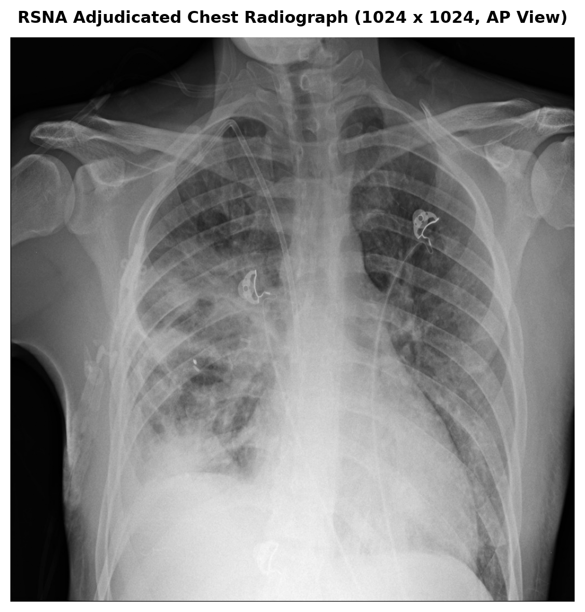

### B. Image Preprocessing Progression
Four-stage deterministic transformation verifying bitwise parity across training, batch evaluation, and single-study inference:

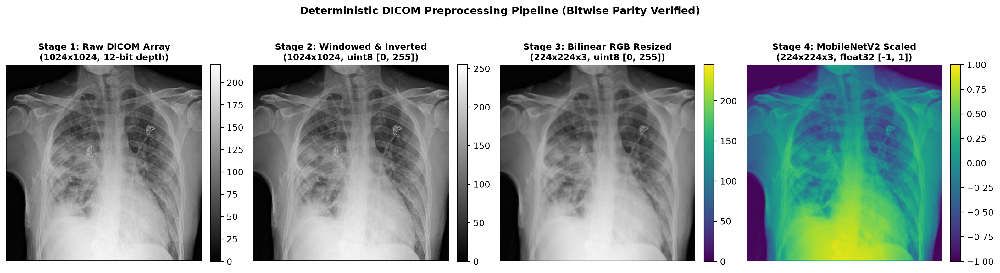

### C. Model Training and Learning History
Terminal execution log of the full-pass baseline training (1 complete epoch across 20,913 images and 1,308 steps), accompanied by the serialized loss and accuracy curves:

| Full-Pass Baseline Training Terminal Log | Training and Validation History Curves |
| :---: | :---: |
| 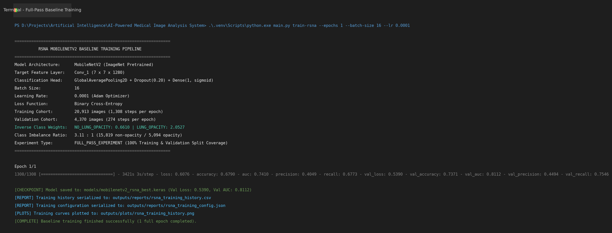 | 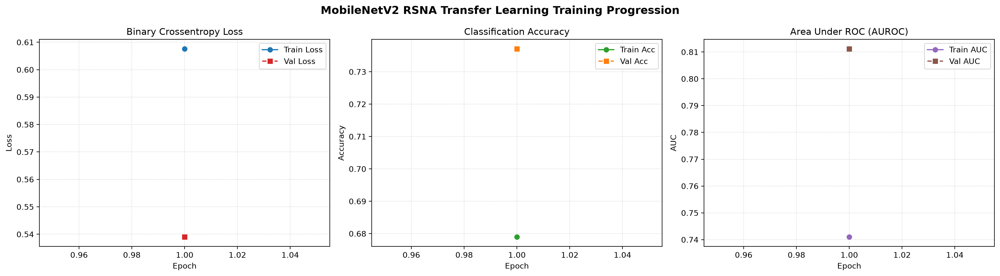 |

### D. Evaluation Results
Held-out test split confusion matrix heatmap (N = 4,401) and Receiver Operating Characteristic (ROC) curve:

| Held-Out Test Confusion Matrix | Receiver Operating Characteristic (AUROC = 0.8238) |
| :---: | :---: |
| 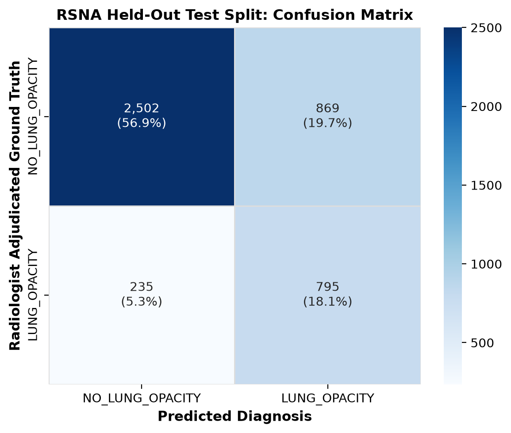 | 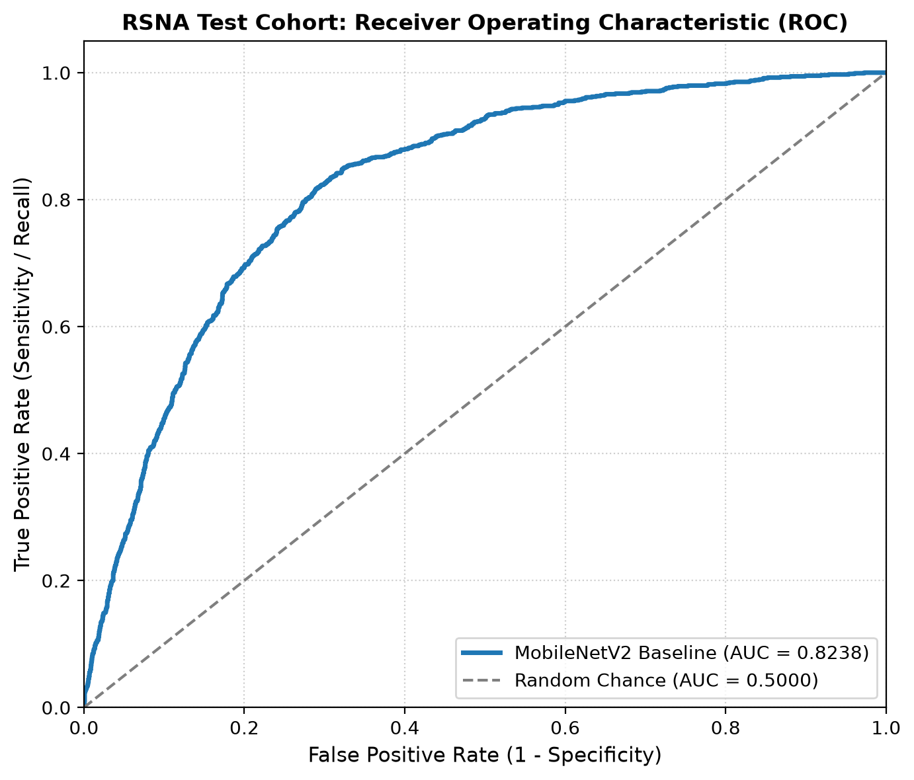 |

### E. Running Inference via Command-Line
Terminal session demonstrating single-study DICOM prediction with Grad-CAM generation, JSON export, and automated overwrite notifications:

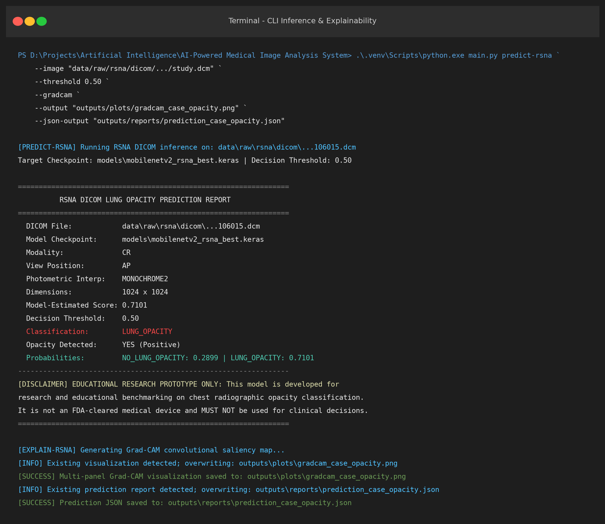

### F. Sample Predictions and Output Reports
Terminal prediction reports and formatted JSON outputs showing privacy-by-default metadata redaction:

| Normal Study Report (Score: 0.1154, Negative) | Opacity Study Report (Score: 0.7101, Positive) |
| :---: | :---: |
| 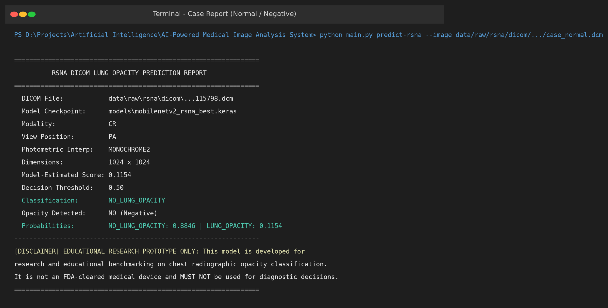 | 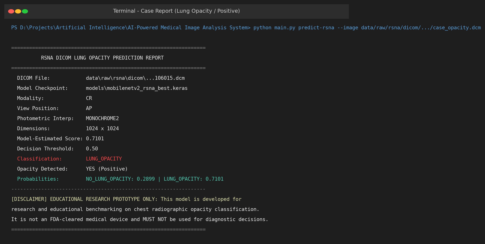 |

Structured prediction JSON output with technical metadata and clinical research disclaimer:

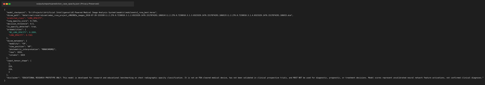

### G. Grad-CAM Explainability Visualizations
Three-panel diagnostic figures showing the preprocessed radiograph, normalized saliency heatmap from layer Conv_1 with colorbar, and blended thoracic overlay:

#### Positive Case: Lung Opacity (Model Score: 0.7101)
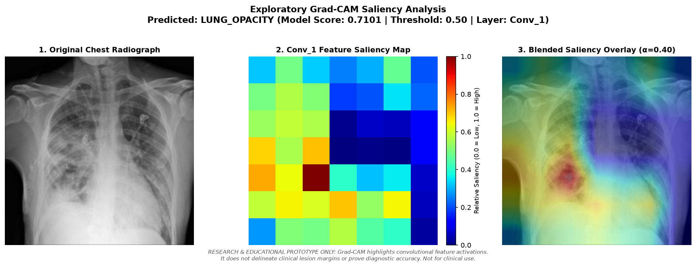

#### Negative Case: Normal Examination (Model Score: 0.1154)
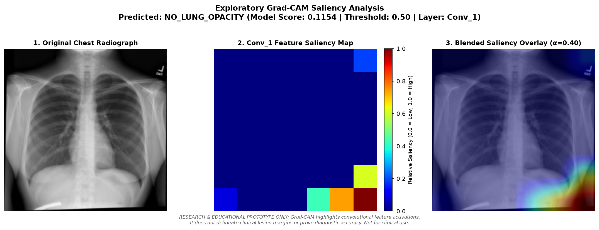

### H. End-to-End Demonstration Dashboard
Composite dashboard combining the input radiograph, quantitative score card, technical DICOM metadata, and Grad-CAM feature attribution:

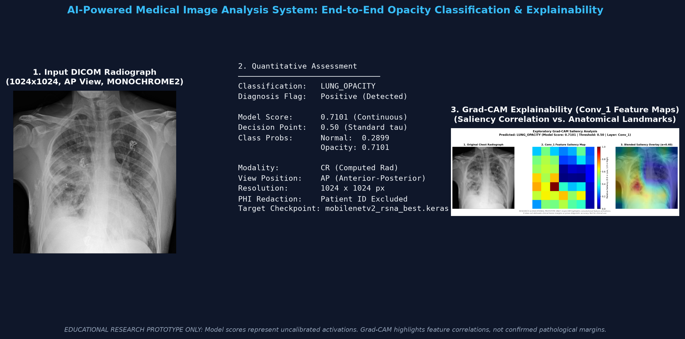

---

## 8. Quickstart and Installation

### System Requirements
- Operating System: Windows 10/11, Ubuntu 20.04+, or macOS
- Python: Version 3.10 or 3.11
- Storage: 20 GB free space (if downloading full RSNA DICOM dataset)
- Memory: Minimum 8 GB RAM (16 GB recommended)

### Step 1: Clone the Repository
```bash
git clone https://github.com/your-username/AI-Medical-Image-Analysis.git
cd AI-Medical-Image-Analysis
```

### Step 2: Initialize Virtual Environment
```powershell
# Windows (PowerShell)
python -m venv .venv
.\.venv\Scripts\Activate.ps1

# Linux / macOS
python3 -m venv .venv
source .venv/bin/activate
```

### Step 3: Install Pinned Dependencies
```bash
pip install --upgrade pip
pip install -r requirements.txt
```

---

## 9. Command-Line Interface Workflows

The system exposes a modular command-line interface through `main.py`:

### A. Run DICOM Prediction with Privacy-by-Default
Execute forward inference on a single DICOM file. Sensitive patient IDs, names, and hospital UIDs are automatically omitted:

```powershell
python main.py predict-rsna --image "data/raw/rsna/dicom/path/to/study.dcm"
```

**Standard Terminal Output (Privacy-Preserved):**
```text
=================================================================
          RSNA DICOM LUNG OPACITY PREDICTION REPORT
=================================================================
  DICOM File:            data\raw\rsna\dicom\...study.dcm
  Model Checkpoint:      models\mobilenetv2_rsna_best.keras
  Modality:              CR
  View Position:         PA
  Photometric Interp:    MONOCHROME2
  Dimensions:            1024 x 1024
  Model-Estimated Score: 0.1154
  Decision Threshold:    0.50
  Classification:        NO_LUNG_OPACITY
  Opacity Detected:      NO (Negative)
  Probabilities:         NO_LUNG_OPACITY: 0.8846 | LUNG_OPACITY: 0.1154
-----------------------------------------------------------------
[DISCLAIMER] EDUCATIONAL RESEARCH PROTOTYPE ONLY: This model is developed for research and educational benchmarking on chest radiographic opacity classification. It is not an FDA-cleared medical device, has not been validated in clinical prospective trials, and MUST NOT be used for diagnostic, prognostic, or treatment decisions. Model scores represent uncalibrated neural network feature activations, not confirmed clinical diagnoses.
=================================================================
```

### B. Run Inference with Grad-CAM and JSON Export
Generate an explainability figure and export structured JSON metrics:

```powershell
python main.py predict-rsna `
    --image "data/raw/rsna/dicom/path/to/study.dcm" `
    --threshold 0.50 `
    --gradcam `
    --output "outputs/plots/gradcam_sample.png" `
    --json-output "outputs/reports/prediction_sample.json"
```

### C. Evaluate Model on Full Held-Out Test Set (4,401 DICOMs)
Stream through the test split and calculate AUROC, Sensitivity, Specificity, and Confusion Matrix:

```powershell
python main.py evaluate-rsna --model-path models/mobilenetv2_rsna_best.keras --threshold 0.50
```

### D. Train Full-Pass RSNA Baseline Model
Execute complete training pass with inverse class weighting and bounded streaming:

```powershell
python main.py train-rsna --epochs 1 --batch-size 16 --lr 0.0001
```

---

## 10. Automated Testing and Quality Assurance

The codebase includes an extensive automated test suite implemented with `pytest`:

```powershell
pytest -q
```

**Automated Test Suite Summary:**
```text
======================== 76 passed in 86.41s ========================
```

The 76 tests verify:
- DICOM decoding, intensity windowing, and MONOCHROME1 inversion math.
- Bitwise preprocessing parity across generator, single-image inference, and batch evaluation.
- Patient-level leak-free data partitioning with zero split overlap.
- Memory-bounded streaming batch generation under load.
- Forward and backward gradient propagation through MobileNetV2.
- Grad-CAM heatmap finite value checks and degenerate attribution suppression.
- Defensive error handling for missing files, corrupt DICOMs, and invalid thresholds.
- Privacy-by-default metadata redaction on stdout and serialized JSON files.

---

## 11. Documented Technical Limitations

1. Single-Epoch Baseline Scope: Checkpoint `models/mobilenetv2_rsna_best.keras` was trained for one full pass across the 20,913-image training cohort. Multi-epoch convergence has not been established; this checkpoint serves as an audited transfer-learning baseline.
2. Uncalibrated Activations: Continuous sigmoid outputs represent neural network feature correlations, not calibrated clinical risk probabilities. Post-hoc calibration (such as temperature scaling) is required before interpreting scores as statistical probabilities.
3. Whole-Image Classification: The model classifies the presence of visual opacity across the entire radiograph; it does not output explicit spatial bounding boxes or segmentation masks.
4. Adult-to-Pediatric Domain Shift: The RSNA cohort consists of adult radiographs from NIH ChestX-ray14. Pediatric lung morphology and pathology presentations differ significantly and require dedicated fine-tuning.

---

## 12. Additional Documentation Resources

- [docs/portfolio_presentation.md](docs/portfolio_presentation.md): Complete 12-slide presentation with speaker notes, live demo script, and reviewer Q&A.
- [docs/portfolio_demo.md](docs/portfolio_demo.md): Detailed 3-5 minute live demonstration guide for Windows PowerShell.
- [images/README.md](images/README.md): Detailed inventory and technical provenance records for all visual assets and proof of work.
- [docs/model_card.md](docs/model_card.md): Formal model card documenting architecture, benchmarks, and operating parameters.
- [docs/dataset_card.md](docs/dataset_card.md): Comprehensive dataset documentation and cohort demographics.
- [docs/architecture.md](docs/architecture.md): Architectural design, sequence flows, and component interactions.
- [docs/limitations.md](docs/limitations.md): Detailed analysis of clinical, calibration, and interpretability constraints.

---

## 13. License and Attribution

### Source Code License
This software codebase is licensed under the [MIT License](LICENSE).

### Data Attribution
- RSNA Pneumonia Detection Challenge: Data provided courtesy of the Radiological Society of North America (RSNA), the Society of Thoracic Radiology (STR), and the National Institutes of Health (NIH).
- Reference: Shih, G., Wu, C. C., Halabi, S. S., et al. "Augmenting the National Institutes of Health Chest Radiograph Dataset with Expert Annotations of Possible Pneumonia", Radiology: Artificial Intelligence (2019), 1(1):e180041. DOI: [10.1148/ryai.2019180041](https://doi.org/10.1148/ryai.2019180041).

