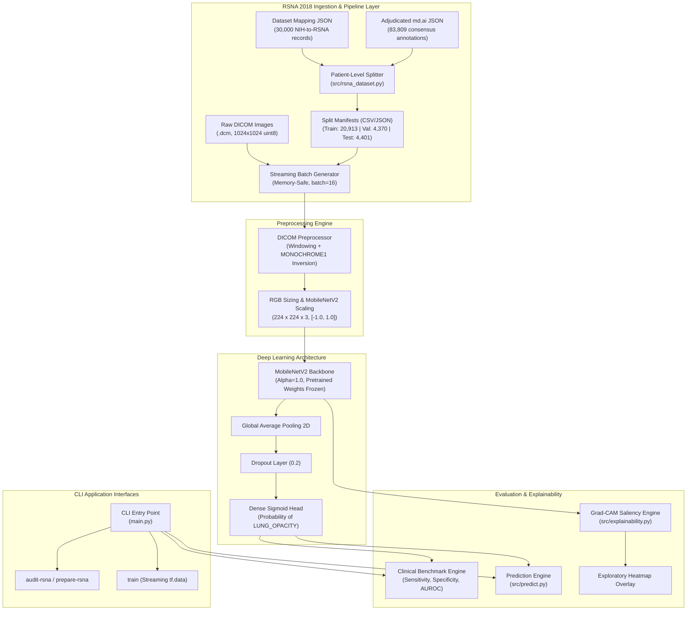

# System Architecture Specification

## 1. Overview
The **AI-Powered Medical Image Analysis System** is engineered as a modular, production-ready computer vision pipeline designed for screening chest radiographs for lung opacities associated with pneumonia. The architecture enforces strict decoupling between data ingestion, image preprocessing, model building, patient-level splitting, streaming batch loading, and explainability.

---

## 2. Core Modules & Responsibilities

| Module | File Path | Primary Responsibility |
| :--- | :--- | :--- |
| **Configuration** | `src/config.py` | Single source of truth for filesystem paths, image dimensions ($224 \times 224 \times 3$), random seed ($42$), and taxonomy constants (`NO_LUNG_OPACITY`, `LUNG_OPACITY`). |
| **RSNA Pipeline** | `src/rsna_dataset.py` | Ingests official RSNA mapping and adjudication schemas, implements standardized label mapping, executes patient-grouped splitting with zero cross-split leakage, generates small CSV manifests, and streams DICOM batches on-the-fly. |
| **Preprocessing** | `src/preprocessing.py` | Converts PIL and DICOM images to 3-channel RGB, performs windowing and photometric inversion, and normalizes pixel intensities to $[-1.0, 1.0]$. |
| **Model** | `src/model.py` | Constructs MobileNetV2 architecture with custom classification head, binary cross-entropy loss, and Adam optimizer. |
| **Data Audit** | `src/data_audit.py` | Audits directory layouts, formats, and corrupted files for generic folder structures. |
| **Training** | `src/train.py` | Orchestrates training iterations with ReduceLROnPlateau and EarlyStopping callbacks. |
| **Evaluation** | `src/evaluate.py` | Computes clinical screening metrics (AUROC, Sensitivity, Specificity, F1) from ground truth labels and model probabilities. |
| **Prediction** | `src/predict.py` | Runs single-image inference and formats structured response dictionaries with confidence scores and non-diagnostic disclaimers. |
| **Explainability** | `src/explainability.py` | Extracts gradient-weighted feature maps via Grad-CAM from convolutional layers and blends heatmaps onto input radiographs. |
| **CLI** | `main.py` | Command-line interface with subcommands: `audit-rsna`, `prepare-rsna`, `audit`, `train`, `evaluate`, and `predict`. |

---

## 3. Data Flow & Memory Management Architecture

### 3.1 Patient-Level Splitting Flow
1. **Mapping Ingestion**: The 30,000-record mapping file (`pneumonia-challenge-dataset-mappings_2018.json`) maps each RSNA UUID to the original NIH CXR8 filename (`XXXXXXXX_YYY.png`).
2. **Patient Identifier Extraction**: The 8-digit prefix (`XXXXXXXX`) is extracted, identifying 12,233 distinct patients in the valid cohort.
3. **Deterministic Partitioning**: Unique patients are sorted and shuffled with a fixed random seed (`seed = 42`). Partition cutoffs assign 70% of patients to Train ($n = 8,563$), 15% to Validation ($n = 1,835$), and 15% to Test ($n = 1,835$).
4. **Leakage Prevention**: All images belonging to a patient follow that patient into their assigned split, guaranteeing:
   $$\text{Train Patients} \cap \text{Val Patients} = \emptyset, \quad \text{Train Patients} \cap \text{Test Patients} = \emptyset, \quad \text{Val Patients} \cap \text{Test Patients} = \emptyset$$
5. **Manifest Serialization**: Manifests are saved as lightweight CSV files (`train_manifest.csv`, `val_manifest.csv`, `test_manifest.csv`, `excluded_manifest.csv`) and `split_summary.json` under `data/processed/rsna/`.

### 3.2 Memory-Safe Streaming Strategy (<1.0 GB Available RAM)
- **Zero Full-Dataset Preloading**: Decoded images are never loaded into memory simultaneously.
- **On-Demand Disk Reading**: The streaming batch generator (`rsna_batch_generator`) reads `.dcm` files in small batches (default `batch_size = 16`).
- **Memory Footprint**: A batch of 16 float32 images of size $224 \times 224 \times 3$ consumes $\approx 9.6\text{ MB}$ of RAM, operating well within the constrained host environment.

---

## 4. Design Principles
1. **Clinical Decoupling**: Classes are explicitly named `LUNG_OPACITY` and `NO_LUNG_OPACITY` to reflect radiological findings rather than definitive clinical diagnoses.
2. **Deterministic Reproducibility**: Fixed random seeds across splitting, generator shuffling, and model initialization guarantee repeatable experimental results.
3. **Stateless Preprocessing**: Pure functional transformations guarantee identical image representations across training, validation, and single-image inference.
4. **Educational Prototype Status**: This architecture is designed for educational and research prototyping only, and is not approved for clinical decision support.
