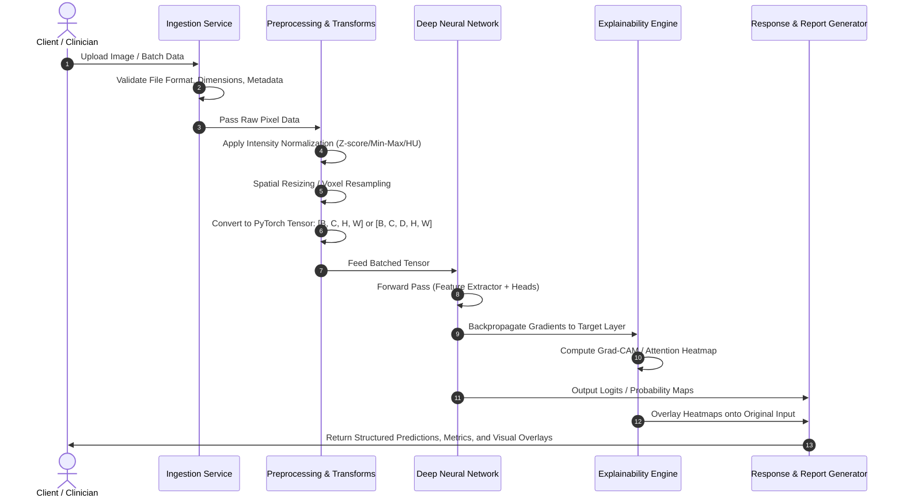

# Data Flow Pipeline Specification

## 1. End-to-End Data Flow

---

## 2. Ingestion Stages & Tensor Transformations

### Stage 1: Raw Input Ingestion
- **Input Types**: 
  - Standard Radiographic 2D: PNG / JPEG / TIFF.
  - Clinical Cross-Sectional: DICOM slices or volumetric NIfTI.
- **Validation**: Checks for corruption, non-standard channel configurations, and invalid bit-depths.

### Stage 2: Normalization & Preprocessing
- **Rescaling**: Converts integer pixel values to floating-point range $[0.0, 1.0]$ or standard normal distribution $\mathcal{N}(0, 1)$.
- **Windowing (Modality-Specific)**:
  - For CT images: Application of Hounsfield Unit (HU) windows (e.g., Lung window: $W=1500, L=-600$; Brain window: $W=80, L=40$).
  - For X-ray / MRI: Contrast-limited adaptive histogram equalization (CLAHE) or percentile clipping ($1\%$ to $99\%$).
- **Spatial Alignment**: Resizing to fixed model input dimensions (e.g., $224 \times 224$ or $512 \times 512$ for 2D, $128 \times 128 \times 128$ for 3D).

### Stage 3: Data Loader & Batch Generation
- **Channel Format**: PyTorch standard format:
  $$\text{Shape: } (B, C, H, W) \quad \text{or} \quad (B, C, D, H, W)$$
  where $B$ is batch size, $C$ is input channels, $D$ is depth (volumetric), $H$ is height, and $W$ is width.
- **Augmentation Pipeline (Training Only)**:
  - Random affine transformations (rotation, translation, scaling).
  - Elastic deformations for anatomical realism.
  - Gaussian noise, brightness/contrast jittering.

### Stage 4: Inference & Post-Processing
- **Activation Functions**: Softmax (multi-class) or Sigmoid (multi-label / binary).
- **Post-Processing**: Morphological cleanup (connected component analysis, hole filling) for segmentation masks; confidence thresholding for classification.

