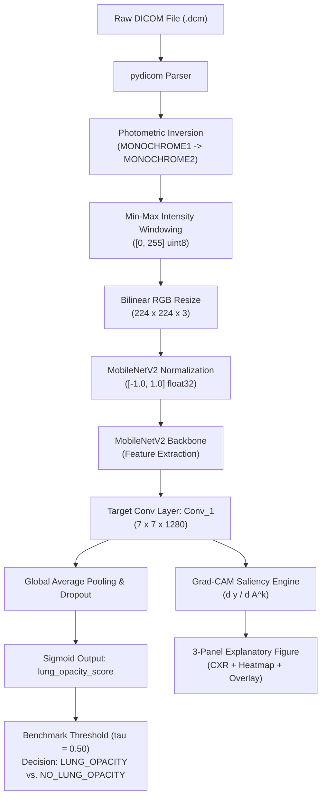

# Student Portfolio Demonstration Guide: AI-Powered Medical Image Analysis System
### RSNA 2018 Adjudicated Chest Radiograph Opacity Classification & Explainability

---

> [!CAUTION]
> ### ⚠️ Mandatory Medical & Educational Research Disclaimer
> **This software is engineered solely for computer vision educational demonstrations, academic research, and engineering portfolio presentation.**
> - It is **NOT** an FDA-cleared, CE-marked, or clinically validated medical diagnostic device.
> - It **MUST NOT** be utilized for clinical diagnosis, patient screening, triage, or clinical management decisions.
> - Model scores reflect continuous, **uncalibrated neural network feature activations**, not confirmed clinical disease likelihoods.
> - Grad-CAM heatmaps highlight coarse convolutional feature correlations, **not** anatomical or pathological lesion margins.

---

## 1. Project Purpose & Educational Scope

Automated thoracic image interpretation offers significant educational value for machine learning engineers, demonstrating how deep convolutional architectures interact with complex medical data formats. This project implements a reproducible, memory-bounded transfer learning and explainability pipeline trained on the **RSNA Pneumonia Detection Challenge (2018)** adjudicated cohort.

### Core Engineering Objectives
1. **DICOM Pipeline Engineering**: Implement streaming data loading, intensity windowing, and photometric interpretation handling (`MONOCHROME1` vs. `MONOCHROME2`) directly from high-resolution clinical DICOMs without exceeding system RAM.
2. **Leak-Free Partitioning**: Enforce strict patient-level hashing to eliminate data contamination across train, validation, and held-out test splits.
3. **Transfer Learning Baseline**: Fine-tune an ImageNet-pretrained **MobileNetV2** architecture for binary classification of radiographic lung opacity.
4. **Visual Interpretability**: Provide mathematically sound, gradient-weighted class activation mapping (Grad-CAM) with explicit handling for degenerate and non-finite attribution.
5. **Privacy-by-Default Architecture**: Strip Protected Health Information (PHI) and DICOM Unique Identifiers (UIDs) from CLI outputs, logs, and serialized reports by default.

---

## 2. System Architecture & Inference Workflow

The platform maintains strict modular separation between data ingestion, model representation, evaluation, inference, and explainability:



### Module Responsibilities
- [`src/config.py`](file:///d:/Projects/Artificial%20Intelligence/AI-Powered%20Medical%20Image%20Analysis%20System/src/config.py): Centralized directory paths, random seed (`42`), image dimensions `(224, 224, 3)`, and operational thresholds.
- [`src/rsna_dataset.py`](file:///d:/Projects/Artificial%20Intelligence/AI-Powered%20Medical%20Image%20Analysis%20System/src/rsna_dataset.py): Manifest ingestion, patient-level split creation, streaming `RSNABatchGenerator`, and DICOM array decoding.
- [`src/preprocessing.py`](file:///d:/Projects/Artificial%20Intelligence/AI-Powered%20Medical%20Image%20Analysis%20System/src/preprocessing.py): Unified preprocessing entrypoint guaranteeing bitwise parity between single-image inference and generator batches.
- [`src/model.py`](file:///d:/Projects/Artificial%20Intelligence/AI-Powered%20Medical%20Image%20Analysis%20System/src/model.py): MobileNetV2 architecture instantiation, custom classification head, and loss compilation.
- [`src/train.py`](file:///d:/Projects/Artificial%20Intelligence/AI-Powered%20Medical%20Image%20Analysis%20System/src/train.py): Training loop, inverse class weighting, and model checkpointing.
- [`src/evaluate.py`](file:///d:/Projects/Artificial%20Intelligence/AI-Powered%20Medical%20Image%20Analysis%20System/src/evaluate.py): Batch-wise test evaluation, AUROC computation, and confusion matrix serialization.
- [`src/predict.py`](file:///d:/Projects/Artificial%20Intelligence/AI-Powered%20Medical%20Image%20Analysis%20System/src/predict.py): Single-study DICOM inference contract, privacy redaction, and non-diagnostic reporting.
- [`src/explainability.py`](file:///d:/Projects/Artificial%20Intelligence/AI-Powered%20Medical%20Image%20Analysis%20System/src/explainability.py): Grad-CAM extraction, finite tensor validation, degenerate attribution handling, and multi-panel visualization.

---

## 3. Dataset Provenance & Target Label Definition

### Official Provenance
- **Source**: Radiological Society of North America (RSNA) Pneumonia Detection Challenge (2018), staged in collaboration with the Society of Thoracic Radiology (STR) and the National Institutes of Health (NIH).
- **Cohort**: 29,684 adjudicated chest radiographs selected from NIH ChestX-ray14.
- **Reference**: Shih, G., Wu, C. C., et al. *"Augmenting the National Institutes of Health Chest Radiograph Dataset with Expert Annotations of Possible Pneumonia"*, *Radiology: Artificial Intelligence* (2019), 1(1):e180041. DOI: [10.1148/ryai.2019180041](https://doi.org/10.1148/ryai.2019180041).

### Precise Label Definition: Lung Opacity vs. Clinical Pneumonia
In medical imaging, an **opacity** is an area of increased attenuation on a radiograph (appearing whiter than surrounding lung parenchyma). It indicates that air space has been replaced by fluid, pus, blood, cells, or atelectasis.
- **Radiological Ground Truth**: Radiologists labeled images exhibiting visual features consistent with pneumonia as `Lung Opacity`. 
- **Clinical Distinction**: A radiographic opacity is an **imaging finding**, NOT a microbiological diagnosis. Opacities can be caused by bacterial pneumonia, viral pneumonia, pulmonary edema, atelectasis, aspiration, or pulmonary infarction.
- **Project Scope**: The model is strictly a **binary classifier of radiographic lung opacity**, not an automated clinician diagnosing pneumonia.

---

## 4. Environment Setup & Windows PowerShell Execution

### Step 1: Environment Activation
```powershell
# Navigate to project workspace
cd "D:\Projects\Artificial Intelligence\AI-Powered Medical Image Analysis System"

# Activate Python 3.11 virtual environment
.\.venv\Scripts\Activate.ps1
```

### Step 2: Basic DICOM Prediction (Privacy-Preserving)
Run forward inference on a single DICOM file. Sensitive patient IDs and UIDs are omitted by default:

```powershell
.\.venv\Scripts\python.exe main.py predict-rsna `
    --image "data/raw/rsna/dicom/mdai_rsna_project_x9N20BZa_images_2018-07-20-153330/1.2.276.0.7230010.3.1.2.8323329.1475.1517874291.115797/1.2.276.0.7230010.3.1.3.8323329.1475.1517874291.115796/1.2.276.0.7230010.3.1.4.8323329.1475.1517874291.115798.dcm"
```

**Observed Terminal Output:**
```text
=================================================================
          RSNA DICOM LUNG OPACITY PREDICTION REPORT
=================================================================
  DICOM File:            data\raw\rsna\dicom\...115798.dcm
  Model Checkpoint:      models\mobilenetv2_rsna_best.keras
  Modality:              CR
  View Position:         PA
  Photometric Interp:    MONOCHROME2
  Dimensions:            1024 x 1024
  Model-Estimated Score: 0.1154
  Decision Threshold:    0.50
  Classification:        NO_LUNG_OPACITY
  Opacity Detected:      NO (Negative)
  Probabilities:         NO_LUNG_OPACITY: 0.8846 | LUNG_OPACITY: 0.1154
-----------------------------------------------------------------
[DISCLAIMER] EDUCATIONAL RESEARCH PROTOTYPE ONLY: This model is developed for research and educational benchmarking on chest radiographic opacity classification. It is not an FDA-cleared medical device, has not been validated in clinical prospective trials, and MUST NOT be used for diagnostic, prognostic, or treatment decisions. Model scores represent uncalibrated neural network feature activations, not confirmed clinical diagnoses.
=================================================================
```

### Step 3: Explainable Inference with Grad-CAM & JSON Export
Generate a multi-panel visual saliency map and export structured, privacy-cleansed metadata:

```powershell
.\.venv\Scripts\python.exe main.py predict-rsna `
    --image "data/raw/rsna/dicom/mdai_rsna_project_x9N20BZa_images_2018-07-20-153330/1.2.276.0.7230010.3.1.2.8323329.1476.1517874291.106014/1.2.276.0.7230010.3.1.3.8323329.1476.1517874291.106013/1.2.276.0.7230010.3.1.4.8323329.1476.1517874291.106015.dcm" `
    --threshold 0.50 `
    --gradcam `
    --output "outputs/plots/gradcam_case_opacity.png" `
    --json-output "outputs/reports/prediction_case_opacity.json"
```

**Artifacts Generated**:
- Image: [`outputs/plots/gradcam_case_opacity.png`](file:///d:/Projects/Artificial%20Intelligence/AI-Powered%20Medical%20Image%20Analysis%20System/outputs/plots/gradcam_case_opacity.png)
- JSON: [`outputs/reports/prediction_case_opacity.json`](file:///d:/Projects/Artificial%20Intelligence/AI-Powered%20Medical%20Image%20Analysis%20System/outputs/reports/prediction_case_opacity.json)

### Step 4: Defensive Error Handling Invocations
```powershell
# 1. Non-existent file path handling (exits with code 1)
.\.venv\Scripts\python.exe main.py predict-rsna --image "data/raw/rsna/dicom/missing.dcm"

# 2. Out-of-bounds decision threshold (exits with code 1)
.\.venv\Scripts\python.exe main.py predict-rsna --image "<path.dcm>" --threshold 1.5
```

---

## 5. Interpreting Model Scores & Operational Thresholds

1. **Continuous Activation (`lung_opacity_score`)**:
   - The output score is a continuous value $y \in [0.0, 1.0]$ produced by the final sigmoid unit.
   - It represents the model's internal feature correlation with training set patterns.
   - **Crucial Caveat**: This score is **uncalibrated**; a score of `0.71` does NOT mean the patient has a 71% statistical probability of pathology.
2. **Fixed Benchmark Threshold ($\tau = 0.50$)**:
   - A standard threshold of $\tau = 0.50$ is applied as the default research operating point.
   - When $y \ge \tau$, the study is classified as `LUNG_OPACITY`; otherwise, `NO_LUNG_OPACITY`.
3. **Omitting Speculative Threshold Adjustments**:
   - Ad-hoc shifts (e.g. asserting $\tau = 0.35$ for screening or $\tau = 0.70$ for specificity) are avoided because clinical thresholds require formal receiver-operator loss-benefit analysis and prospective validation.

---

## 6. Grad-CAM Visualization & Attribution Caveats

Grad-CAM identifies convolutional feature map regions that positively contributed to the final class score.

### Gradient Mechanics
$$\alpha_k = \frac{1}{Z} \sum_{i=1}^U \sum_{j=1}^V \frac{\partial y}{\partial A_{i,j}^k}$$
$$L_{\text{Grad-CAM}} = \text{ReLU}\left(\sum_k \alpha_k A^k\right)$$

- **Target Layer**: `Conv_1` (the last $7 \times 7 \times 1280$ convolutional layer of MobileNetV2).
- **Panel Layout**:
  - **Panel 1**: Preprocessed chest radiograph (normalized with MONOCHROME inversion).
  - **Panel 2**: Normalized feature saliency map ($0.0 = \text{low}$, $1.0 = \text{high}$) with colorbar.
  - **Panel 3**: Blended overlay ($\alpha=0.40$) aligning features over thoracic anatomy.
- **Degenerate Attribution Guard**: If $\max(L_{\text{Grad-CAM}}) = 0$ (no positive gradients), the pipeline suppresses false colormap synthesis and renders the uncolored radiograph labeled `[Zero Positive Attribution / Degenerate]`.
- **Interpretability Limitation**: Saliency heatmaps indicate **feature correlation**, NOT radiological proof of lesion borders, bacterial consolidation, or microbial margins.

---

## 7. Baseline Benchmarks on Held-Out Test Cohort

The model was evaluated strictly on the **held-out RSNA test split** (4,401 cases: 3,371 No Lung Opacity, 1,030 Lung Opacity) using fixed threshold $\tau = 0.50$:

| Metric | Measured Value | Clinical Interpretation for Reviewers |
| :--- | :--- | :--- |
| **AUROC** | **0.8238** | Threshold-independent discriminative capability across all operational points. |
| **Accuracy** | **74.91%** (3,297 / 4,401) | Overall correct classification rate on the test split. |
| **Sensitivity (Recall)** | **77.18%** (795 / 1,030) | Proportion of true opacity cases correctly identified by the baseline. |
| **Specificity** | **74.22%** (2,502 / 3,371) | Proportion of normal cases correctly ruled out. |
| **Precision (PPV)** | **47.78%** (795 / 1,664) | Positive predictive value (reflects natural 23.4% opacity prevalence in test cohort). |
| **F1-Score** | **0.5902** | Harmonic mean of precision and recall. |

### Test Split Confusion Matrix
$$\begin{pmatrix} TN & FP \\ FN & TP \end{pmatrix} = \begin{pmatrix} 2,502 & 869 \\ 235 & 795 \end{pmatrix}$$

---

## 8. Training Limitations & Baseline Boundary

- **Single Complete Pass**: The active model checkpoint was trained for **1 complete epoch** across the full training cohort (20,913 images across 1,308 batches) and validated over the full validation cohort (4,370 images across 274 batches).
- **Convergence Caveat**: Multi-epoch training convergence has not been established. This checkpoint serves as an audited transfer-learning baseline rather than a fully optimized deep learning model.
- **Resource Discipline**: Training utilized inverse class frequency weighting and bounded streaming generators to operate strictly within standard desktop RAM limits without memory spikes.

---

## 9. Privacy Precautions for Presentations & Artifact Sharing

Medical DICOM files embed institutional, equipment, and patient identifiers. This codebase implements **Privacy-by-Default**:
1. **Header Stripping**: `PatientID`, `StudyInstanceUID`, and `SOPInstanceUID` are omitted from CLI reports, logs, and output JSON files.
2. **Opt-in Only**: The `--include-patient-id` flag is restricted to authenticated local auditing.
3. **Repository Cleanliness**: The project `.gitignore` explicitly prevents raw DICOMs, model weights, and generated reports/plots from being tracked or pushed to Git.
4. **Presentation Safeguards**: When capturing slides or demonstration screenshots, verify that no local filesystem paths revealing institutional or private usernames are visible.

---

## 10. Suggested 3–5 Minute Presentation Sequence

| Timeline | Slide / Focus | Key Talking Points |
| :--- | :--- | :--- |
| **0:00 – 0:45** | **Problem & Scope** | Introduce chest radiograph opacity classification. Emphasize that this is an **educational research prototype** exploring computer vision engineering, not a clinical diagnostic device. |
| **0:45 – 1:45** | **Engineering Architecture** | Explain streaming DICOM ingestion (`RSNABatchGenerator`), photometric inversion (`MONOCHROME1` to `MONOCHROME2`), and leak-free patient-level hashing across 29,684 adjudicated cases. |
| **1:45 – 2:45** | **Quantitative Performance** | Present the held-out test benchmarks ($N=4,401$): AUROC `0.8238`, Sensitivity `77.18%`, Specificity `74.22%`. Explain why precision is `47.78%` due to cohort prevalence. |
| **2:45 – 3:45** | **Explainability & Grad-CAM** | Demonstrate a live inference invocation. Show the 3-panel Grad-CAM visualization from `Conv_1`. Explain the degenerate-attribution safeguard and why heatmaps are exploratory rather than diagnostic. |
| **3:45 – 4:30** | **Limitations & Reflection** | Note that the baseline completed 1 complete epoch (convergence not established), discuss probability calibration caveats, and highlight privacy-by-default architecture. |

---

## 11. Reviewer Questions & Evidence-Based Answers

### Q1: Why did you frame this as lung opacity detection instead of pneumonia diagnosis?
> **Answer**: In the RSNA 2018 challenge, expert thoracic radiologists adjudicated chest radiographs for visual areas of "lung opacity consistent with pneumonia." Radiographs visualize physical attenuation (air space consolidation), not microbiological pathogens. Conflating an imaging opacity with clinical pneumonia ignores non-infectious causes (edema, atelectasis, infarction) and misrepresents an engineering model as an automated clinician.

### Q2: Why did you stop after 1 complete training epoch instead of running 20 epochs?
> **Answer**: The full RSNA training split contains 20,913 images. A single complete epoch constitutes 1,308 gradient update steps with a batch size of 16. The goal of this phase was to establish a verified, leak-free, full-coverage transfer-learning baseline. Running 20 epochs without establishing baseline correctness risks wasting computational resources and masking data leakage. Multi-epoch tuning with learning rate scheduling remains future work.

### Q3: Why is precision 47.78% when accuracy is 74.91%?
> **Answer**: Precision (Positive Predictive Value) is heavily dependent on cohort prevalence. In our held-out test split, positive opacity cases comprise only 23.4% (1,030 / 4,401) of the cohort. At a fixed threshold of 0.50, the model yields 795 True Positives and 869 False Positives:
> $$\text{PPV} = \frac{795}{795 + 869} \approx 47.78\%$$
> In medical screening, maintaining sensitivity ($\approx 77.2\%$) to minimize false negatives is generally prioritized over precision.

### Q4: How do you guarantee zero data leakage between training and evaluation splits?
> **Answer**: Patients frequently have multiple radiographs in the RSNA dataset. Partitioning images randomly would cause radiographs from the same patient to appear in both training and test sets. We extracted the unique patient identifier for each case, applied a deterministic cryptographic hash (`hashlib.sha256`) with a fixed seed (`42`), and partitioned strictly at the patient level (approx. 70% train, 15% validation, 15% test).

### Q5: Can Grad-CAM be used by a clinician to locate the exact infection boundary?
> **Answer**: No. Grad-CAM computes gradients at layer `Conv_1`, which has a spatial resolution of $7 \times 7$ feature maps. When upsampled to $224 \times 224$, the resulting heatmap provides only a coarse regional representation of features that influenced the model. It cannot delineate anatomical margins, differentiate bacterial consolidation from atelectasis, or replace expert radiologist interpretation.

### Q6: How did you ensure patient privacy in your implementation?
> **Answer**: DICOM headers contain protected health information (PHI) including Patient ID, Study UIDs, and equipment metadata. Our pipeline implements privacy-by-default: metadata extraction functions exclude sensitive identifiers unless an explicit `--include-patient-id` flag is passed. CLI stdout and serialized JSON reports contain only technical image attributes (e.g. modality, view position, dimensions), and `.gitignore` prevents datasets, models, and outputs from entering source control.

