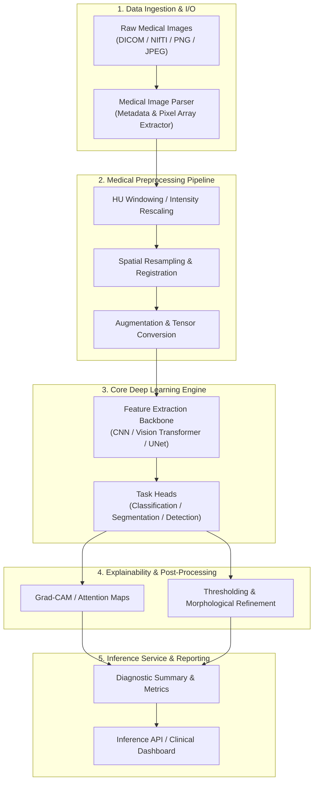

# System Architecture Specification

## 1. High-Level Overview
The **AI-Powered Medical Image Analysis System** is structured as a modular, end-to-end computer vision and deep learning platform tailored for clinical decision support. The system supports multi-modal imaging ingestion, preprocessing and normalization, deep neural network inference (classification, segmentation, and lesion detection), explainability visualization (Grad-CAM/CAM), and structured diagnostic report generation.

---

## 2. Architectural Layers

### 2.1 Ingestion & Normalization Layer
- **Responsibility**: Ingest raw imaging data, parse medical headers (e.g., DICOM tags, voxel spacing, orientation), normalize intensity values (Hounsfield units windowing for CT, min-max or z-score for MRI/X-ray), and generate standardized tensors.
- **Key Formats**: DICOM (`.dcm`), NIfTI (`.nii`, `.nii.gz`), 2D formats (`.png`, `.jpg`).

### 2.2 Deep Learning Model Layer
- **Responsibility**: Execute forward inference passes across trained neural network architectures.
- **Architectural Paradigms**:
  - Encoder-Decoder architectures (e.g., U-Net, Attention U-Net) for pixel/voxel-level lesion segmentation.
  - Deep Convolutional / Vision Transformer backbones (e.g., ResNet, EfficientNet, Swin UNETR) for pathology classification.

### 2.3 Explainability (XAI) Layer
- **Responsibility**: Ensure interpretability of predictions for clinicians by generating saliency maps, class activation mappings (Grad-CAM), and uncertainty estimations.

### 2.4 Service & Evaluation Layer
- **Responsibility**: Expose interfaces for batch inference or API endpoints, monitor data drift, and compute clinical evaluation metrics.

---

## 3. Technology Stack Foundation
- **Language**: Python 3.10+
- **Deep Learning Framework**: PyTorch / PyTorch Lightning / MONAI
- **Image Processing**: OpenCV, SimpleITK, Albumentations, SciPy, Pillow
- **Data Engineering**: NumPy, Pandas
- **Evaluation & Metrics**: Scikit-learn, TorchMetrics, MedPy

