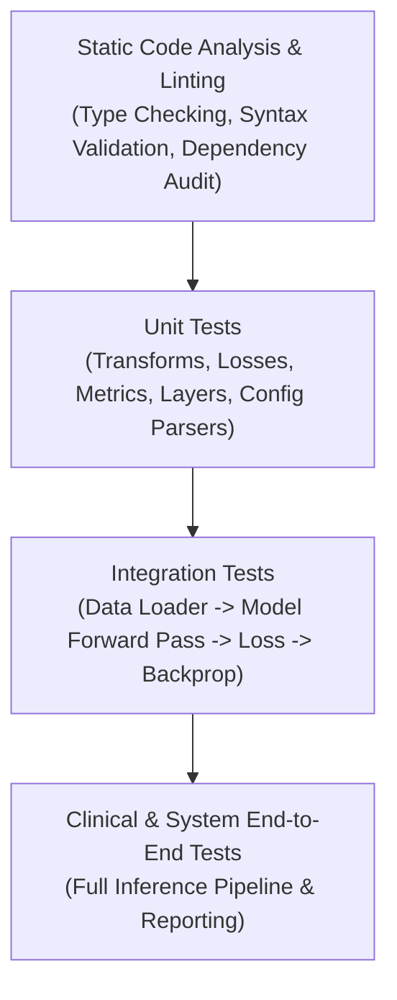

# Verification, Validation & Testing Protocol

This document outlines the rigorous verification methodology used to establish the correctness, reliability, and clinical utility of all implemented code, modules, and models.

---

## 1. Verification Pyramid

---

## 2. Testing Layers & Verification Criteria

### 2.1 Unit Testing
- **Transforms & Preprocessors**: Verify input-output tensor shapes, value bounds ($[0, 1]$ or $\mathcal{N}(0, 1)$), determinism with fixed seeds, and invariant properties.
- **Model Components**: Verify parameter counts, activation dimensions across intermediate layers, and correct handling of variable batch sizes.
- **Loss Functions**: Verify non-negativity, zero-loss on identical predictions, and correct gradient non-vanishing.

### 2.2 Integration Testing
- **Overfitting on a Single Batch**: A fundamental deep learning sanity check. Ensure the model can achieve near 100% accuracy or $\sim 0.0$ loss on a 2-4 sample micro-batch, proving backward pass correctness and gradient flow.
- **Data Pipeline Throughput**: Ensure DataLoader queues tensors without I/O bottlenecking the GPU/accelerator.

### 2.3 Evaluation & Clinical Metrics Checklist

| Metric | Target Application | Formula / Interpretation |
| :--- | :--- | :--- |
| **AUROC (Area Under ROC)** | Multi-label / Binary Classification | Overall diagnostic discriminative ability across all operating thresholds. |
| **Sensitivity (Recall)** | Screening / High-risk Pathology | $\frac{TP}{TP + FN}$ — Minimizes false negatives (missed diseases). |
| **Specificity** | Diagnostic Confirmation | $\frac{TN}{TN + FP}$ — Minimizes false alarms. |
| **Dice Similarity Coeff (DSC)** | Lesion / Organ Segmentation | $\frac{2 |X \cap Y|}{|X| + |Y|}$ — Spatial overlap between ground truth and prediction. |
| **Mean IoU (Jaccard Index)** | Segmentation | $\frac{|X \cap Y|}{|X \cup Y|}$ — Overlap measure. |

---

## 3. Implementation Verification Checklist
For every feature or module implemented, the following verification checklist must be satisfied before marking the step as complete:
- [ ] Code syntax and type checking passes.
- [ ] Unit tests written and executing with 100% pass rate.
- [ ] Tensor shape transformations validated across all dimensions.
- [ ] Memory consumption and GPU memory leak check passed.
- [ ] Results documented in [`implementation_progress_log.md`](./implementation_progress_log.md).

